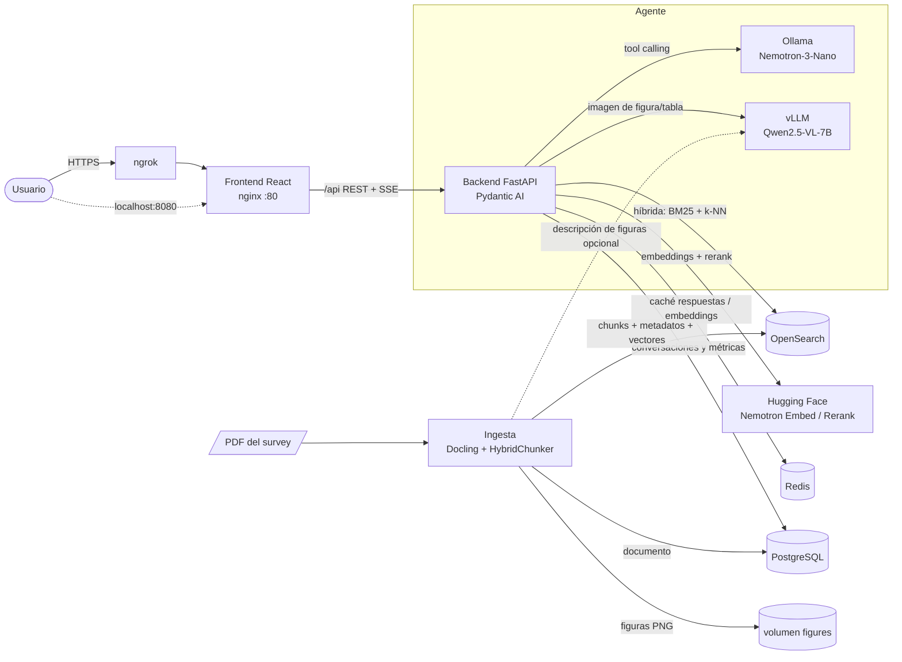

Agente Académico

Agente conversacional que responde preguntas sobre un artículo científico tipo **survey (revista Q1)**,
con respuestas fundamentadas, **citas de sección y página**, y la capacidad de decir *"esto no está en el
artículo"* en lugar de inventar. Incluye un panel **/admin** protegido con estadísticas de uso.

**Integrantes:** Pedro Gomez y Yuting Lin  

| Stack obligatorio | Dónde se usa |
|---|---|
| **Docling** | Conversión del PDF conservando secciones, tablas, figuras con pie y referencias; chunking jerárquico (`backend/ingest/ingest.py`) |
| **Hugging Face** | Embeddings `nvidia/Nemotron-3-Embed-1B-BF16` y reranker `nvidia/llama-nemotron-rerank-1b-v2` (sentence-transformers / transformers) |
| **OpenSearch** | Índice k-NN (HNSW, coseno, dimensión del modelo) + BM25 + **búsqueda híbrida** con *search pipeline* (`backend/app/search.py`) |
| **Pydantic AI** | Agente con 3 *tools*, salida tipada `RespuestaAgente`, validador de citas y reintentos (`backend/app/agent.py`) |
| **Ollama** | Sirve **Nemotron-3-Nano**: el cerebro del agente (razonamiento + tool calling) |
| **vLLM** | Sirve **Qwen2.5-VL-7B-Instruct**: preguntas sobre figuras y tablas (visión), descripción de figuras al ingerir y juez de la evaluación |
| **PostgreSQL** | Conversaciones, mensajes, métricas, citas, recuperación y evaluaciones con un esquema normalizado ([docs/esquema_bd.md](docs/esquema_bd.md)) |
| **Redis** | Caché de respuestas y de embeddings de consultas, con su efecto en la latencia medido |
| **React** | Chat con streaming, historial, fuentes y estados de carga y error; panel /admin con gráficas y filtros |
| **Docker** | Todo levanta con `docker compose up -d` (healthchecks, volúmenes, `.env`) |
| **ngrok** | Servicio en el compose que publica la UI para la demo |

---

## 1. Arquitectura



**Flujo de una pregunta**

1. La UI envía la pregunta a `POST /api/chat/stream` (SSE) junto con el `conversation_id`.
2. El backend guarda el mensaje en PostgreSQL. Si es el primer turno y la pregunta ya está en **Redis**, responde desde la caché.
3. Si no, ejecuta el **agente Pydantic AI** (modelo en Ollama) con el historial de la conversación:
   - `buscar_en_articulo(consulta, tipo)`: embedding de la consulta (cacheado en Redis), luego **búsqueda híbrida** en OpenSearch (BM25 + k-NN combinados con *normalization-processor*), y por último **reranking** de los 20 candidatos, de los que se quedan los 6 mejores.
   - `indice_del_articulo()`: secciones con su página.
   - `analizar_figura_o_tabla(chunk_id, pregunta)`: envía la imagen recortada por Docling a **Qwen2.5-VL en vLLM**.
4. El agente devuelve `RespuestaAgente {respondible, respuesta, citas[chunk_id], confianza}`. Un **validador** rechaza citas de fragmentos que no se recuperaron y obliga a buscar antes de responder (`ModelRetry`). Si nada respalda la respuesta, el agente devuelve `respondible=false`.
5. El backend completa las citas con la sección, la página y la imagen reales desde OpenSearch (el LLM nunca escribe páginas), y guarda la respuesta, las citas, los fragmentos, los tokens y la latencia por etapa en PostgreSQL.
6. La UI muestra el texto en streaming, las fuentes (sección · página, con el fragmento y la imagen) y las métricas.

---

## 2. Instalación reproducible

### Requisitos

- Linux con GPU NVIDIA y **NVIDIA Container Toolkit** (`docker run --gpus all nvidia/cuda:12.4.0-base-ubuntu22.04 nvidia-smi` debe funcionar)
- Docker Engine 24+ con Compose v2
- ~70 GB de disco libre (modelos e imágenes), 32 GB de RAM recomendados
- Cuenta de Hugging Face (token de lectura) y de ngrok (authtoken gratuito)

### Pasos

```bash
# 1) Configuración
cp .env.example .env
#    editar .env: contraseñas, JWT_SECRET, HF_TOKEN, NGROK_AUTHTOKEN (y modelos según tu GPU, ver sección 3)

# 2) Artículo
cp ~/Descargas/mi-survey.pdf data/papers/

# 3) Levantar todo (la primera vez descarga modelos: 15 a 40 min)
docker compose up -d --build

# 4) Seguir el progreso
docker compose logs -f ingest ollama-pull vllm backend
docker compose ps            # todos "healthy"; ingest y ollama-pull terminan con "Exited (0)"
```

- UI: <http://localhost:8080>
- Panel: <http://localhost:8080/admin> (usuario y clave del `.env`)
- URL pública para la demo: <http://localhost:4040> (inspector de ngrok) o `docker compose logs ngrok | grep url=`
- Salud: <http://localhost:8080/api/health>

Para reingerir después de cambiar el PDF o los parámetros de chunking:

```bash
docker compose run --rm ingest python -m ingest.ingest --force
# con descripción de figuras con Qwen2.5-VL (vLLM debe estar healthy):
docker compose run --rm ingest python -m ingest.ingest --force --describir-figuras
```

La conversión de Docling queda en `data/processed/<doc>.md`, `.json` y `.chunks.jsonl`. Sirve como evidencia de que se conservan las secciones, tablas, figuras y referencias.

### Desarrollo local de la UI

```bash
cd frontend && npm install && npm run dev     # http://localhost:5173 (proxy /api a localhost:8000)
```

---

## 3. Hardware y elección de modelos

> **Hardware utilizado en la demo:** _completar (GPU, VRAM, RAM, CPU, SO)_. Ejemplo: 1× RTX 4090 24 GB, 64 GB RAM, Ubuntu 22.04.

| Perfil de GPU | `VLLM_MODEL` | `VLLM_GPU_UTIL` | `OLLAMA_MODEL` | Notas |
|---|---|---|---|---|
| **≥ 48 GB** (A6000, L40S, A100, 2×24 GB) | `Qwen/Qwen2.5-VL-7B-Instruct` | 0.45 | `nemotron-3-nano` | Configuración recomendada y la que viene por defecto |
| **24 GB** (RTX 3090/4090) | `Qwen/Qwen2.5-VL-3B-Instruct` | 0.40 | `nemotron-3-nano` | Ollama descarga parte del MoE a RAM (necesita ≥ 32 GB de RAM). Si va lento, usar `qwen3:8b` |
| **12-16 GB** | `Qwen/Qwen2.5-VL-3B-Instruct-AWQ` (`VLLM_MAX_MODEL_LEN=8192`) | 0.45 | `qwen3:4b` | Funciona, pero con respuestas menos precisas |
| **Sin GPU** | — | — | — | No soportado: vLLM requiere GPU. Como alternativa, usar una VM con GPU (Runpod, Lambda, GCP) |

Los embeddings y el reranker (≈1B parámetros cada uno) corren en **CPU** por defecto (`EMBED_DEVICE=cpu`) para dejar la VRAM a los LLM. La ingesta de un survey de 30 páginas tarda unos minutos en CPU.

**¿Por qué cada modelo?**

- **Nemotron-3-Nano en Ollama (agente).** Es un MoE con ≈3B parámetros activos: razona y hace *tool calling* fiable a la velocidad de un modelo pequeño. Ollama facilita la cuantización (GGUF) y la descarga parcial a CPU, que es lo que permite que quepa junto a vLLM en una sola GPU.
- **Qwen2.5-VL-7B en vLLM (visión y juez).** Es el único modelo multimodal del stack, así que contesta preguntas sobre figuras y tablas a partir de la imagen. vLLM da *batching* continuo y una API compatible con OpenAI con soporte de imágenes. Como juez de la evaluación, un modelo distinto al generador reduce el sesgo de autoevaluación.
- **Nemotron-3-Embed-1B (embeddings).** Es multilingüe (preguntas en español, artículo en inglés) y su contexto es largo. Si no se puede cargar, el sistema pasa automáticamente a `BAAI/bge-m3`. La dimensión del índice k-NN se lee del modelo cargado.
- **llama-nemotron-rerank-1b-v2 (reranker).** Es un cross-encoder que reordena los 20 candidatos híbridos. Su mejora se mide en `eval_retrieval` (fallback: `BAAI/bge-reranker-v2-m3`).

Para usar vLLM también como agente: `AGENT_BACKEND=vllm` (vLLM ya arranca con `--enable-auto-tool-choice --tool-call-parser hermes`).

---

## 4. Ingesta y RAG

- **Docling** (`PdfPipelineOptions`): estructura de tablas con *cell matching*, imágenes de figuras y páginas a escala 2×, título, encabezados y referencias.
- **Chunking jerárquico** con `HybridChunker`. No mezcla secciones, fusiona párrafos hermanos pequeños y limita a `CHUNK_MAX_TOKENS=512` tokens del tokenizer. Cada chunk se indexa *contextualizado* (con su ruta de encabezados antepuesta).
- **Metadatos** por chunk: `doc_id`, `section`, `headings[]`, `page_start`, `page_end`, `chunk_type` (`text|table|figure|reference`), `caption`, `image_path`, `order`.
- **Tablas** en un chunk propio en Markdown, con su pie e imagen. **Figuras** en un chunk propio con su pie, la imagen PNG y una descripción opcional generada por Qwen2.5-VL.
- **Índice OpenSearch**: `knn_vector` HNSW (`m=16`, `ef_construction=128`, `cosinesimil`, motor lucene) y un analizador inglés con stemming para BM25.
- **Híbrida**: consulta `hybrid` con `[multi_match, knn]` y el pipeline `normalization-processor` (min-max + media aritmética con pesos 0.3 / 0.7).

**Justificación de parámetros** (se verifica con `eval_retrieval`, que incluye un barrido de pesos):

| Parámetro | Valor | Motivo |
|---|---|---|
| `CHUNK_MAX_TOKENS` | 512 | Un párrafo largo o una subsección corta de un survey. Más grande diluye el embedding; más pequeño corta definiciones. |
| `RETRIEVAL_CANDIDATES` | 20 | Margen suficiente para que el reranker recupere fragmentos que la híbrida dejó en las posiciones 7 a 20. |
| `RETRIEVAL_TOP_K` | 6 | ≈3k tokens de contexto: cabe holgado en 16k junto al historial. |
| Pesos híbridos | 0.3 léxico / 0.7 vectorial | El vectorial cubre la paráfrasis y el cruce español-inglés. El léxico rescata siglas, nombres de métodos y datasets. |

---

## 5. Evaluación (rúbrica 2 y 4, y puntos extra)

```bash
# a) Recuperación: ¿la híbrida y el rerank mejoran? (evidencia de rúbrica 2 + extra de reranking)
docker compose exec backend python -m eval.generar_qrels --n 40      # preguntas sintéticas con su chunk de origen
docker compose exec backend python -m eval.eval_retrieval            # -> backend/eval/resultados/retrieval.md

# b) Calidad de respuestas con LLM como juez (≥ 15 preguntas)
#    Primero ADAPTEN backend/eval/preguntas.json a su artículo (respuesta_esperada y páginas)
docker compose exec backend python -m eval.run_eval --label final    # -> resultados/eval_final.md y pestaña Evaluación de /admin

# c) Efecto de Redis en la latencia
docker compose exec backend python -m eval.bench_cache               # -> resultados/cache.md
```

- `eval_retrieval` compara **bm25, knn, hybrid y hybrid_rerank** con Recall@1/3/5/10, MRR@10, nDCG@10 y latencia.
- `run_eval` (20 preguntas, 4 de ellas imposibles de responder y 1 multiturno) mide **faithfulness, relevancia y corrección** (1 a 5, con un juez Qwen2.5-VL de salida tipada), además de la **abstención correcta** y la **presencia de citas**.

> Peguen aquí las tablas de `resultados/retrieval.md`, `resultados/eval_final.md` y `resultados/cache.md` después de correrlas.

---

## 6. Panel /admin

Requiere login (usuario y clave en `.env`, token JWT con expiración). Todo se lee de PostgreSQL:

- **Indicadores:** consultas, conversaciones, tokens de entrada y salida (totales y por consulta), tiempo promedio con p50 y p95, tasa de caché, abstenciones, errores y llamadas a herramientas
- **Gráficas:** consultas por día, latencia por día, **latencia por etapa** (embedding, búsqueda, rerank, visión, LLM) y **uso por modelo**
- **Efecto de Redis:** latencia con y sin caché y aceleración, además de un botón para vaciar la caché
- **Preguntas y respuestas:** tabla paginada con tokens y tiempos. Al hacer clic se ven los fragmentos recuperados, los puntajes y las llamadas a cada modelo.
- **Filtros:** fechas, modelo, caché, respondible y texto
- **Evaluación:** resultados de la última corrida de `run_eval`

---

## 7. Estructura

```
Agente-Academico/
├── docker-compose.yml        # 10 servicios con healthchecks y volúmenes
├── .env.example              # plantilla de configuración (sin secretos)
├── backend/
│   ├── app/
│   │   ├── agent.py          # agente Pydantic AI (tools, salida tipada, validación)
│   │   ├── search.py         # OpenSearch: índice k-NN, pipeline híbrido, recuperador
│   │   ├── embeddings.py     # embeddings HF
│   │   ├── reranker.py       # reranker HF
│   │   ├── cache.py          # Redis
│   │   ├── service.py        # orquestación de un turno + persistencia de métricas
│   │   ├── routers/          # chat (REST + SSE) y admin (JWT)
│   │   └── main.py
│   ├── ingest/ingest.py      # Docling → chunks → OpenSearch
│   ├── eval/                 # preguntas, juez, recuperación, benchmark de caché
│   └── sql/schema.sql        # esquema normalizado
├── frontend/                 # React + Vite (chat y /admin), servido por nginx
├── data/papers/              # aquí va el PDF (ignorado por git)
└── docs/                     # esquema de BD, evidencia Q1
```

---

## 8. Artículos sugeridos (surveys en revistas Q1)

Verifiquen el cuartil en [SJR](https://www.scimagojr.com/) para el año de publicación y la categoría, y guarden la captura en `docs/img/`:

1. **Ji, Z. et al. (2023).** *Survey of Hallucination in Natural Language Generation.* ACM Computing Surveys 55(12). DOI 10.1145/3571730 (preprint: arXiv 2202.03629). Combina muy bien con un agente que "no inventa".
2. **Wu, Z. et al. (2021).** *A Comprehensive Survey on Graph Neural Networks.* IEEE Transactions on Neural Networks and Learning Systems 32(1). DOI 10.1109/TNNLS.2020.2978386 (arXiv 1901.00596). Tiene muchas tablas y figuras, ideal para probar Qwen2.5-VL.
3. **Barredo Arrieta, A. et al. (2020).** *Explainable Artificial Intelligence (XAI): Concepts, taxonomies, opportunities and challenges toward responsible AI.* Information Fusion 58. DOI 10.1016/j.inffus.2019.12.012 (arXiv 1910.10045).

---

## 9. Seguridad

- No hay credenciales en el repositorio: todo vive en `.env`, que está en `.gitignore`. Antes de cada push, revisen con `git status` que `.env` no aparezca.
- OpenSearch, PostgreSQL, Redis, Ollama y vLLM **no publican puertos**: solo son accesibles dentro de la red de Docker. Solo se exponen el frontend (8080) y el inspector de ngrok (4040).
- `/admin` exige un JWT firmado con `JWT_SECRET`, y la comparación de credenciales es de tiempo constante.

## 10. Solución de problemas

| Síntoma | Solución |
|---|---|
| `could not select device driver "nvidia"` | Instalar NVIDIA Container Toolkit y reiniciar Docker |
| vLLM `CUDA out of memory` | Bajar `VLLM_GPU_UTIL` o `VLLM_MAX_MODEL_LEN`, o usar el modelo 3B o AWQ (sección 3) |
| "No pude conectar con el servidor de modelos" | `docker compose logs ollama-pull vllm`: el modelo todavía se descarga |
| "El índice de OpenSearch no existe" | Falta el PDF en `data/papers/`. Copiarlo y ejecutar `docker compose run --rm ingest` |
| OpenSearch no arranca (`max virtual memory areas`) | `sudo sysctl -w vm.max_map_count=262144` |
| ngrok se reinicia en bucle | Falta `NGROK_AUTHTOKEN` en `.env` |
| Nemotron Embed o Rerank no carga | Se usa el fallback automático (ver logs). Revisar `HF_TOKEN` y la licencia aceptada en HF |
