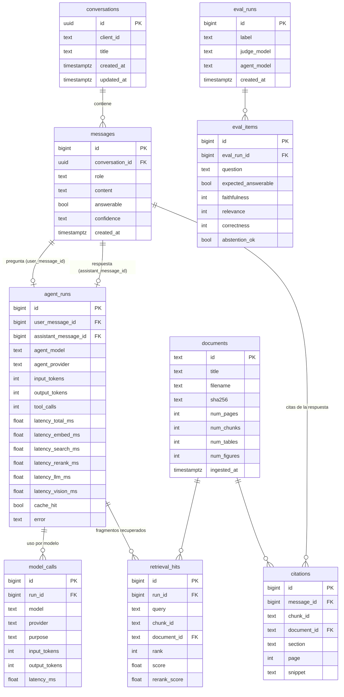

# Esquema de PostgreSQL

Definido en [`backend/sql/schema.sql`](../backend/sql/schema.sql). Está en tercera forma normal: cada
hecho se guarda una sola vez y las métricas se relacionan con el mensaje que las produjo.



| Tabla | Para qué sirve |
|---|---|
| `documents` | Artículos ingeridos con Docling (hash para no reingerir, conteo de tablas y figuras). |
| `conversations` | Una conversación por cliente anónimo (id guardado en el navegador). |
| `messages` | Turnos de usuario y asistente. El asistente guarda si pudo responder y su confianza. |
| `agent_runs` | Una fila por respuesta: tokens de entrada y salida, latencia total y por etapa, caché y errores. |
| `model_calls` | Detalle por modelo (agente en Ollama, visión en vLLM, embeddings y reranker de HF). Alimenta "uso por modelo". |
| `retrieval_hits` | Qué fragmentos recuperó el agente, con qué consulta y con qué puntaje (híbrido y rerank). |
| `citations` | Citas (sección y página) que aparecen en la respuesta final. |
| `eval_runs` / `eval_items` | Resultados de la evaluación automática con LLM como juez. |
| `v_qa` (vista) | Une pregunta, respuesta y métricas. Es la base del panel /admin. |

Consultas útiles:

```sql
-- Tiempo promedio y tokens por modelo
SELECT agent_model, count(*), avg(latency_total_ms), sum(input_tokens), sum(output_tokens)
FROM agent_runs GROUP BY 1;

-- Efecto de Redis
SELECT cache_hit, avg(latency_total_ms) FROM agent_runs WHERE error IS NULL GROUP BY 1;
```
